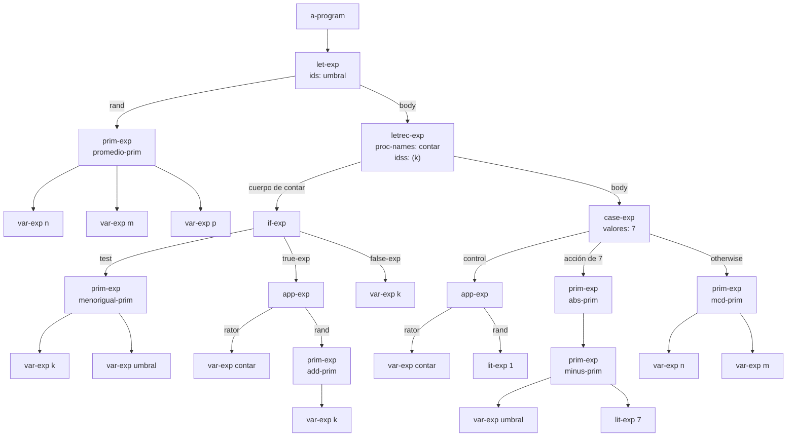
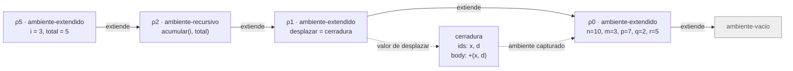

# Informe de AST — Taller 2: El intérprete de Cauca

**Curso:** Fundamentos de Interpretación y Compilación de Lenguajes
de Programación — Universidad del Valle, Sede Tuluá.

**Integrantes del grupo:**

| Nombre                     | Código  | Correo institucional                   |
|----------------------------|---------|----------------------------------------|
| Santiago alexander Criollo | 2380661 | santiago.criollo@correounivalle.edu.co |

---

## 1. Gramática considerada

Gramática completa de Cauca. El nombre de cada constructor del AST va debajo de su producción.

```bnf
<programa>  ::= <expresion>
                a-program(exp)

<expresion> ::= <numero>
                lit-exp(dato)
            ::= <identificador>
                var-exp(id)
            ::= "true"
                true-exp()
            ::= "false"
                false-exp()
            ::= <primitiva> "(" {<expresion>}*(,) ")"
                prim-exp(prim, rands)
            ::= "if" <expresion> "then" <expresion> "else" <expresion> "end"
                if-exp(test, true-exp, false-exp)
            ::= "let" {<identificador> "=" <expresion>}* "in" <expresion> "end"
                let-exp(ids, rands, body)
            ::= "proc" "(" {<identificador>}*(,) ")" <expresion> "end"
                proc-exp(ids, body)
            ::= "apply" <expresion> "(" {<expresion>}*(,) ")"
                app-exp(rator, rands)
            ::= "letrec" {<identificador> "(" {<identificador>}*(,) ")" "=" <expresion>}*
                "in" <expresion> "end"
                letrec-exp(proc-names, idss, bodies, body)
            ::= "case" <expresion> {"of" <numero> "=>" <expresion>}*
                "otherwise" "=>" <expresion> "end"
                case-exp(exp, valores, acciones, default)

<primitiva> ::= "+" sum-prim()          ::= "-" minus-prim()
            ::= "*" mult-prim()         ::= "/" div-prim()
            ::= "add1" add-prim()       ::= "sub1" sub-prim()
            ::= ">" mayor-prim()        ::= ">=" mayorigual-prim()
            ::= "<" menor-prim()        ::= "<=" menorigual-prim()
            ::= "==" igual-prim()       ::= "not" not-prim()
            ::= "and" and-prim()        ::= "or" or-prim()
            ::= "abs" abs-prim()        ::= "mcd" mcd-prim()
            ::= "mcm" mcm-prim()        ::= "promedio" promedio-prim()
            ::= "xor" xor-prim()        ::= "implica" implica-prim()
            ::= "entre" entre-prim()
```

---

## 2. Ejemplos de AST

### Ejemplo 1 — let, letrec, case, aplicación y primitivas anidadas

**Expresión concreta:**

```scheme
let umbral = promedio(n, m, p)
in
  letrec
    contar (k) = if <=(k, umbral)
                 then apply contar (add1(k))
                 else k
                 end
  in
    case apply contar (1)
      of 7 => abs(-(umbral, 7))
      otherwise => mcd(n, m)
    end
  end
end
```

**AST:**



**Explicación:** la raíz es `a-program`, que envuelve un `let-exp` con una sola ligadura, `umbral`. Su rand es un `prim-exp` con `promedio-prim` y tres `var-exp`. El cuerpo del `let` es un `letrec-exp` que declara `contar` con parámetro `k`. El cuerpo de `contar` es un `if-exp`: el test es un `prim-exp` con `menorigual-prim`, la rama verdadera es un `app-exp` que llama a `contar` con `add1(k)`, y la rama falsa es `var-exp k`. El cuerpo del `letrec-exp` es un `case-exp` cuya expresión de control es `apply contar (1)`. Tiene una rama para el literal 7, con `abs(-(umbral, 7))` (dos `prim-exp` anidados), y una rama `otherwise` con `mcd(n, m)`.

Con el ambiente inicial, $umbral = 20/3$, $contar(1) = 7$ y el resultado del programa es $|20/3 - 7| = 1/3$.

---

## 3. Traza de evaluación

**Expresión a evaluar:**

```scheme
let desplazar = proc (x, d) +(x, d) end
in
  letrec
    acumular (i, total) = if >(i, m)
                          then total
                          else apply acumular
                                 (add1(i), apply desplazar (total, i))
                          end
  in
    apply acumular (1, q)
  end
end
```

**Ambiente inicial:** $\rho_0 = [\,n = 10,\ m = 3,\ p = 7,\ q = 2,\ r = 5\,]$.

Una cerradura se escribe $\langle ids,\ body,\ \rho \rangle$ y $[x = v]\rho$ es el ambiente $\rho$ extendido con $x = v$.

**Pasos de la traza:**

**Paso 1.** $\text{value-of}(\texttt{let-exp},\, \rho_0)$.

- Se evalúa el rand en $\rho_0$: $\text{value-of}(\texttt{proc (x, d) +(x, d) end},\, \rho_0) = c_d = \langle (x, d),\ \texttt{+(x, d)},\ \rho_0 \rangle$.
- El cuerpo del `let` se evalúa en $\rho_1 = [\,desplazar = c_d\,]\rho_0$.

**Paso 2.** $\text{value-of}(\texttt{letrec-exp},\, \rho_1)$.

- No se construye ninguna cerradura todavía.
- El cuerpo se evalúa en $\rho_2 = \texttt{ambiente-recursivo}(acumular,\ (i, total),\ body_{acum},\ \rho_1)$.

**Paso 3.** $\text{value-of}(\texttt{apply acumular (1, q)},\, \rho_2)$.

- Operador: $\text{apply-env}(\rho_2, acumular) = c_a = \langle (i, total),\ body_{acum},\ \rho_2 \rangle$, con $\rho_2$ como ambiente capturado.
- Rands: $\text{value-of}(\texttt{1}, \rho_2) = 1$ y $\text{value-of}(\texttt{q}, \rho_2) = 2$ (la búsqueda de `q` recorre $\rho_2$ y $\rho_1$ hasta $\rho_0$).
- `apply-procedure` evalúa el cuerpo en $\rho_3 = [\,i = 1,\ total = 2\,]\rho_2$.

**Paso 4.** $\text{value-of}(body_{acum},\, \rho_3)$.

- $\text{value-of}(\texttt{>(i, m)},\, \rho_3) = (1 > 3) = \text{false}$, así que se evalúa la rama `else`.
- $\text{value-of}(\texttt{add1(i)},\, \rho_3) = 2$.
- $\text{value-of}(\texttt{apply desplazar (total, i)},\, \rho_3)$: el operador da $c_d$, los argumentos son $(2, 1)$ y el cuerpo se evalúa en $[\,x = 2,\ d = 1\,]\rho_0$, con resultado $+(2, 1) = 3$.
- Llamada: `apply acumular (2, 3)`.

**Paso 5** (primera llamada recursiva). Ambiente $\rho_4 = [\,i = 2,\ total = 3\,]\rho_2$.

- $\text{value-of}(\texttt{>(i, m)},\, \rho_4) = (2 > 3) = \text{false}$.
- $\text{value-of}(\texttt{add1(i)},\, \rho_4) = 3$.
- $\texttt{apply desplazar (3, 2)}$ se evalúa en $[\,x = 3,\ d = 2\,]\rho_0$ y da $5$.
- Llamada: `apply acumular (3, 5)`.

**Paso 6** (segunda llamada recursiva). Ambiente $\rho_5 = [\,i = 3,\ total = 5\,]\rho_2$.

- $\text{value-of}(\texttt{>(i, m)},\, \rho_5) = (3 > 3) = \text{false}$.
- $\text{value-of}(\texttt{add1(i)},\, \rho_5) = 4$.
- $\texttt{apply desplazar (5, 3)}$ se evalúa en $[\,x = 5,\ d = 3\,]\rho_0$ y da $8$.
- Llamada: `apply acumular (4, 8)`.

**Paso 7.** Ambiente $\rho_6 = [\,i = 4,\ total = 8\,]\rho_2$.

- $\text{value-of}(\texttt{>(i, m)},\, \rho_6) = (4 > 3) = \text{true}$.
- Se evalúa la rama `then`: $\text{value-of}(\texttt{total},\, \rho_6) = 8$.

**Resultado del programa:** $8$.

**Diagrama de la cadena de ambientes** en la segunda llamada recursiva a `acumular` (ambiente $\rho_5$, paso 6). Las flechas continuas van del ambiente que extiende hacia el ambiente extendido. La flecha punteada muestra la cerradura de `desplazar` y el ambiente que capturó.



---

## 4. Estado del almacén en una transacción

No aplica a este taller: Cauca no tiene almacén ni bloques transaccionales.

---

## 5. Referencias

- Friedman, D. P., & Wand, M. *Essentials of Programming Languages*, 3.ª ed., MIT Press, 2008. Sección 3.2 (el lenguaje LET), sección 3.3 (procedimientos y clausuras) y sección 3.4 (procedimientos recursivos, Figura 3.9).
- Documentación de Racket: *Parsing with SLLGEN* en el lenguaje `eopl`.