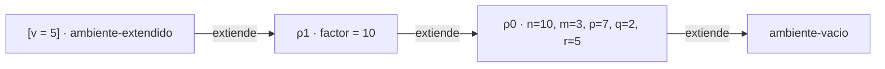
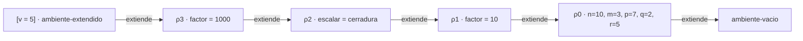
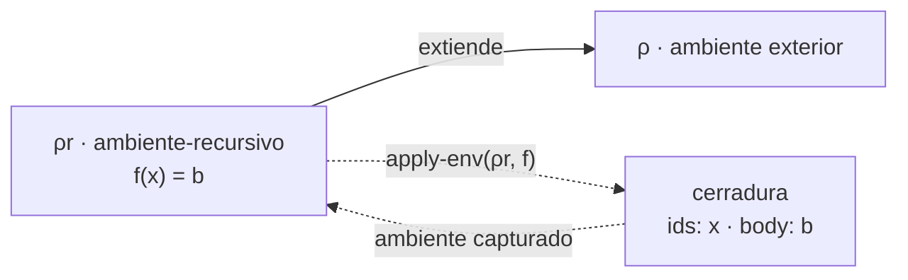

# Informe de corrección — Taller 2: El intérprete de Cauca

**Curso:** Fundamentos de Interpretación y Compilación de Lenguajes
de Programación — Universidad del Valle, Sede Tuluá.

**Integrantes del grupo:**

| Nombre                     | Código  | Correo institucional                   |
|----------------------------|---------|----------------------------------------|
| santiago alexander criollo | 2380661 | santiago.criollo@correounivalle.edu.co |

---

## 1. Marco formal

### 1.1 Corrección de programas recursivos

Sea $f : A \to B$ una función y $A$ un conjunto definido
recursivamente. Sea $P_f$ un programa recursivo en Racket que
pretende calcular $f$. Decimos que $P_f$ es correcto con respecto a
su especificación si se cumple:

$$
\forall a \in A \,:\, P_f(a) = f(a)
$$

La estrategia de demostración es la **inducción estructural** sobre $A$:

- **Caso base:** para cada valor básico $a_0 \in A$ se verifica $P_f(a_0) = f(a_0)$.
- **Caso inductivo:** asumiendo la **hipótesis de inducción** $P_f(a') = f(a')$ para las subestructuras $a'$ que forman $a$, se demuestra $P_f(a) = f(a)$.

### 1.2 Corrección de programas iterativos

Las funciones analizadas aquí son recursivas y no iterativas, así que no se usa un estado con invariante de lazo. La noción de invariante aparece en la sección 2.2, pero aplicada a un ambiente y no a un proceso iterativo.

### 1.3 Notación de la semántica de Cauca

- $\rho$ denota un ambiente. $[\,\bar{x} = \bar{v}\,]\rho$ es el ambiente $\rho$ extendido con las ligaduras $x_i = v_i$ (variante `ambiente-extendido`).
- $\text{rec}(\bar{f}, \bar{X}, \bar{b}, \rho)$ es el `ambiente-recursivo` con nombres $\bar{f}$, listas de parámetros $\bar{X}$ y cuerpos $\bar{b}$, que extiende a $\rho$.
- $\langle \bar{x},\ b,\ \rho \rangle$ es una cerradura con parámetros $\bar{x}$, cuerpo $b$ sin evaluar y ambiente de definición $\rho$.
- $\text{value-of}(e, \rho)$ es la evaluación de la expresión $e$ en $\rho$. Las reglas que se usan son:

$$
\begin{aligned}
\text{value-of}(\texttt{lit-exp}(n), \rho) &= n \\
\text{value-of}(\texttt{var-exp}(x), \rho) &= \text{apply-env}(\rho, x) \\
\text{value-of}(\texttt{proc-exp}(\bar{x}, b), \rho) &= \langle \bar{x},\ b,\ \rho \rangle \\
\text{value-of}(\texttt{app-exp}(r, \bar{e}), \rho) &= \text{apply-procedure}(\text{value-of}(r, \rho),\ [\text{value-of}(e_i, \rho)]_i) \\
\text{value-of}(\texttt{let-exp}(\bar{x}, \bar{e}, b), \rho) &= \text{value-of}(b,\ [\,\bar{x} = [\text{value-of}(e_i, \rho)]_i\,]\rho) \\
\text{value-of}(\texttt{letrec-exp}(\bar{f}, \bar{X}, \bar{b}, b), \rho) &= \text{value-of}(b,\ \text{rec}(\bar{f}, \bar{X}, \bar{b}, \rho))
\end{aligned}
$$

---

## 2. Funciones analizadas

### 2.1 Corrección de `apply-procedure`

**Especificación.**

- **Tipo:** `apply-procedure : procval x lista de valores -> valor`
- **Pre-condición:** $\text{Pre}(p, \bar{v}) \equiv p = \langle \bar{x},\ b,\ \rho_c \rangle \,\land\, \bar{v}$ es una lista de valores.
- **Post-condición:**

$$
\text{Post}(p, \bar{v}, r) \equiv
\begin{cases}
r = \text{value-of}(b,\ [\,\bar{x} = \bar{v}\,]\rho_c) & \text{si } |\bar{x}| = |\bar{v}| \\
\text{se levanta } \texttt{eopl:error} & \text{si } |\bar{x}| \neq |\bar{v}|
\end{cases}
$$

La corrección es parcial: si evaluar el cuerpo no termina, la llamada tampoco.

**Código.**

```racket
;; apply-procedure : procval x lista de valores -> valor
;; Verifica que la cantidad de argumentos coincida con la de parámetros y
;; evalúa el cuerpo en el ambiente de la clausura extendido con los
;; parámetros, no en el ambiente de la llamada.
(define apply-procedure
  (lambda (proc args)
    (cases procval proc
      (cerradura (ids body env)
        (if (= (length ids) (length args))
            (evaluar-expresion body (ambiente-extendido ids args env))
            (eopl:error 'apply-procedure
                        "El procedimiento espera ~s argumentos y recibió ~s"
                        (length ids) (length args)))))))
```

Y las ramas de `evaluar-expresion` que construyen y aplican procedimientos:

```racket
(proc-exp (ids body)
  (cerradura ids body env))
(app-exp (rator rands)
  (let ((proc (evaluar-expresion rator env)))
    (if (procval? proc)
        (let ((args (evaluar-rands rands env)))
          (apply-procedure proc args))
        (eopl:error 'app-exp "El operador no es un procedimiento: ~s" proc))))
```

**Estrategia de demostración:** razonamiento directo sobre el código y sobre la forma en que se construyen las cerraduras. No hay recursión estructural propia en estas funciones.

**Demostración 1: el cuerpo se evalúa en el ambiente de la clausura extendido.**

Sea $p = \langle \bar{x},\ b,\ \rho_c \rangle$ y $\bar{v}$ la lista de argumentos.

1. Por `cases procval`, las variables `ids`, `body` y `env` quedan ligadas a $\bar{x}$, $b$ y $\rho_c$.
2. Si $|\bar{x}| = |\bar{v}|$, el resultado es `(evaluar-expresion body (ambiente-extendido ids args env))`, es decir $\text{value-of}(b,\ [\,\bar{x} = \bar{v}\,]\rho_c)$, que es la post-condición.
3. `apply-procedure` recibe solo `proc` y `args`: el ambiente donde ocurre la llamada no es un parámetro suyo y por eso no puede usarlo. Es una garantía estructural, no una convención.
4. El ambiente $\rho_c$ lo fija `proc-exp`: $\text{value-of}(\texttt{proc-exp}(\bar{x}, b), \rho) = \langle \bar{x},\ b,\ \rho \rangle$, con $\rho$ el ambiente donde se evaluó la definición. $\blacksquare$

**Las dos cadenas del ejemplo de contraste.**

```scheme
let factor = 10
in
  let escalar = proc (v) *(v, factor) end
  in
    let factor = 1000
    in
      apply escalar (5)
    end
  end
end
```

Los ambientes que se construyen, con $\rho_0 = [\,n = 10,\ m = 3,\ p = 7,\ q = 2,\ r = 5\,]$:

$$
\begin{aligned}
\rho_1 &= [\,factor = 10\,]\rho_0 \\
c &= \langle (v),\ \texttt{*(v, factor)},\ \rho_1 \rangle \quad\text{(el rand se evalúa en } \rho_1\text{)} \\
\rho_2 &= [\,escalar = c\,]\rho_1 \\
\rho_3 &= [\,factor = 1000\,]\rho_2 \quad\text{(la llamada ocurre en } \rho_3\text{)}
\end{aligned}
$$

**Resultado correcto (50).** El cuerpo se evalúa en $[\,v = 5\,]\rho_1$, el ambiente de la clausura extendido. La búsqueda de `factor` encuentra $10$ y el resultado es $5 \cdot 10 = 50$.



**Resultado incorrecto (5000).** Si el cuerpo se evaluara en $[\,v = 5\,]\rho_3$, el ambiente de la llamada, la búsqueda de `factor` encontraría primero $1000$ y el resultado sería $5 \cdot 1000 = 5000$. Esta cadena **no** es la que construye `apply-procedure`.



Las dos cadenas se diferencian en el eslabón que sigue a $[\,v = 5\,]$: la primera continúa en $\rho_1$ (definición) y la segunda en $\rho_3$ (llamada). Por la demostración 1, el código produce la primera.

**Demostración 2: la aplicación levanta error exactamente cuando el operador no es un procedimiento o la cantidad de argumentos no coincide.**

Se considera solo el error propio de la aplicación, no los errores que se propagan al evaluar subexpresiones (operador, argumentos o cuerpo).

- ($\Rightarrow$) Las únicas llamadas a `eopl:error` alcanzables desde `app-exp` y `apply-procedure` son la rama `else` del `if` con `procval?` y la rama `else` del `if` con `(= (length ids) (length args))`. La primera se ejecuta solo si `(procval? proc)` es falso, es decir, si el operador no es un procedimiento. La segunda solo si las longitudes son distintas.
- ($\Leftarrow$) Si el operador no es un procedimiento, `(procval? proc)` es falso y se toma la rama del error. Si es un procedimiento con $|\bar{x}| \neq |\bar{v}|$, se llega a `apply-procedure` y `(= (length ids) (length args))` es falso, así que se levanta el error.

Los dos chequeos están ordenados: el del operador ocurre antes de evaluar los argumentos, de modo que con un operador que no es procedimiento los argumentos no se evalúan. $\blacksquare$

**Conclusión:** `apply-procedure` evalúa el cuerpo en el ambiente de definición extendido con los parámetros, y la aplicación falla exactamente en los dos casos previstos.

---

### 2.2 Corrección de la ligadura recursiva (`letrec` y `apply-env`)

**Especificación.**

- **Tipo:** `apply-env : ambiente x symbol -> valor`, restringida a un `ambiente-recursivo`.
- **Pre-condición:** $\rho_r = \text{rec}(\bar{f}, \bar{X}, \bar{b}, \rho)$, con $\bar{f} = (f_1, \ldots, f_n)$ distintos, $\bar{X} = (\bar{x}_1, \ldots, \bar{x}_n)$ y $\bar{b} = (b_1, \ldots, b_n)$.
- **Post-condición:** se cumple el invariante $\text{Inv}(\rho_r)$ del siguiente apartado.

**Código.**

```racket
;; apply-env : ambiente x symbol -> valor
;; Busca el identificador respetando el shadowing; levanta eopl:error si no
;; está ligado. En un ambiente-recursivo construye la cerradura con ese mismo
;; ambiente.
(define apply-env
  (lambda (env id)
    (cases ambiente env
      (ambiente-vacio ()
        (eopl:error 'apply-env "Variable no ligada: ~s" id))
      (ambiente-extendido (ids valores amb)
        (let ((pos (posicion id ids 0)))
          (if pos
              (list-ref valores pos)
              (apply-env amb id))))
      (ambiente-recursivo (proc-names idss bodies amb)
        (let ((pos (posicion id proc-names 0)))
          (if pos
              (cerradura (list-ref idss pos) (list-ref bodies pos) env)
              (apply-env amb id)))))))
```

**Invariante.** Sea $\rho_r = \text{rec}(\bar{f}, \bar{X}, \bar{b}, \rho)$ el ambiente en el que se evalúa el cuerpo de un `letrec`. Debe cumplirse:

$$
\text{Inv}(\rho_r) \equiv
\Big(\forall i \in \{1..n\}:\ \text{apply-env}(\rho_r, f_i) = \langle \bar{x}_i,\ b_i,\ \rho_r \rangle\Big)
\ \land\
\Big(\forall y \notin \bar{f}:\ \text{apply-env}(\rho_r, y) = \text{apply-env}(\rho, y)\Big)
$$

La primera parte dice que cada procedimiento declarado se encuentra en $\rho_r$ y que su clausura captura el propio $\rho_r$, que contiene los nombres de todos los procedimientos del `letrec`, incluido el suyo. La segunda dice que los demás nombres se resuelven como en el ambiente exterior.



**Demostración 1: `apply-env` sobre un `ambiente-recursivo` satisface el invariante.**

Sea `env` $= \rho_r$. En la rama `ambiente-recursivo` de `apply-env`, `proc-names`, `idss`, `bodies` y `amb` quedan ligados a $\bar{f}$, $\bar{X}$, $\bar{b}$ y $\rho$.

- **Parte 1.** Sea $y = f_i$. Como los nombres son distintos, `(posicion id proc-names 0)` retorna $i - 1$ (índice desde 0) y el código retorna `(cerradura (list-ref idss pos) (list-ref bodies pos) env)`, o sea $\langle \bar{x}_i,\ b_i,\ \rho_r \rangle$, porque `env` es el ambiente recursivo completo y no `amb`.
- **Parte 2.** Sea $y \notin \bar{f}$. `posicion` retorna `#f` y el código llama `(apply-env amb id)`, que es $\text{apply-env}(\rho, y)$. $\blacksquare$

**Consecuencia: la recursión y la recursión mutua funcionan.** El cuerpo de $f_i$ se evalúa, por `apply-procedure`, en $[\,\bar{x}_i = \bar{v}\,]\rho_r$. Una llamada a $f_j$ dentro de ese cuerpo hace $\text{apply-env}([\,\bar{x}_i = \bar{v}\,]\rho_r, f_j)$. Si $f_j \notin \bar{x}_i$, la búsqueda baja a $\rho_r$ y, por el invariante, retorna $\langle \bar{x}_j,\ b_j,\ \rho_r \rangle$ para todo $j$, incluido $j = i$ (recursión directa) y $j \neq i$ (recursión mutua). Un parámetro con el mismo nombre que un procedimiento lo oculta, que es el comportamiento esperado de un lenguaje con alcance léxico.

Como los ambientes son inmutables, la cerradura se reconstruye en cada búsqueda y las cerraduras obtenidas en momentos distintos son estructuralmente iguales. No hace falta un ciclo real en memoria: el ciclo se simula entregando $\rho_r$ al reconstruir la clausura (EOPL, sección 3.4, Figura 3.9).

**Demostración 2: la misma declaración escrita con `let` no satisface el invariante.**

```scheme
let fact = proc (n) if ==(n, 0) then 1 else *(n, apply fact (sub1(n))) end end
in
  apply fact (5)
end
```

Con $\rho$ el ambiente exterior:

1. El rand de un `let` se evalúa en $\rho$, antes de que `fact` esté ligado: $c = \langle (n),\ b,\ \rho \rangle$.
2. El cuerpo del `let` se evalúa en $\rho' = [\,fact = c\,]\rho$.
3. Al invocar $c$, el cuerpo $b$ se evalúa en $[\,n = 5\,]\rho$.
4. Dentro de $b$, `apply fact (...)` hace $\text{apply-env}([\,n = 5\,]\rho, fact)$. Como $\rho$ no contiene `fact`, la búsqueda llega al ambiente vacío y se levanta el error `apply-env: Variable no ligada: fact`.

El invariante falla en su primera parte: la clausura de $f_i$ debería capturar un ambiente que ligue $f_i$, pero captura $\rho$, que no lo contiene. Si existiera un `fact` en $\rho$, no se levantaría error y se llamaría silenciosamente a la función equivocada.

La causa de fondo es un problema de orden: con ambientes inmutables, la clausura debe existir antes que el ambiente que la contiene ($c$ antes de $\rho'$), y el ambiente capturado debería ser $\rho'$. `let` no puede construir esa referencia circular. `letrec` sí, porque no crea la clausura al declarar sino al buscar el nombre, con $\rho_r$ ya construido. $\blacksquare$

**Demostración 3: terminación del ejemplo de `potencia`.**

```scheme
letrec
  potencia (base, exp) = if ==(exp, 0)
                         then 1
                         else *(base, apply potencia (base, sub1(exp)))
                         end
in
  apply potencia (2, 10)
end
```

Sea $\mu(\text{llamada}) = exp \in \mathbb{N}$ el valor del segundo argumento.

- La llamada inicial tiene $\mu = 10$.
- Si $exp \neq 0$, la única llamada recursiva es `potencia(base, sub1(exp))`, con $\mu' = \mu - 1 < \mu$.
- Si $exp = 0$, la rama `then` retorna $1$ sin llamadas recursivas.

La medida es un natural que decrece en $1$ en cada llamada y tiene cota inferior $0$, donde no hay más llamadas. Como no existe una cadena infinita estrictamente decreciente en $\mathbb{N}$, la recursión termina. Para el ejemplo, son $11$ invocaciones con $\mu = 10, 9, \ldots, 0$.

**Corrección del valor (por inducción sobre $exp$).** Sea $P(e) = $ `potencia(b, e)`. Caso base: $P(0) = 1 = b^0$. Caso inductivo: si $P(e - 1) = b^{e-1}$, entonces $P(e) = b \cdot P(e - 1) = b \cdot b^{e-1} = b^e$. Por lo tanto $P(10)$ con $b = 2$ es $2^{10} = 1024$. $\blacksquare$

**Conclusión:** `apply-env` sobre un `ambiente-recursivo` construye clausuras que capturan el propio ambiente recursivo, lo que permite recursión directa y mutua; `let` no lo logra; y el ejemplo de `potencia` termina con resultado $1024$.

---

### 2.3 Corrección de `case-exp`

**Especificación.**

- **Tipo:** `evaluar-expresion : expresion x ambiente -> valor`, en la variante `case-exp`.
- **Pre-condición:** $e = \texttt{case-exp}(c,\ \bar{a},\ \bar{e},\ d)$ con $\bar{a} = (a_1, \ldots, a_k)$ literales numéricos, $\bar{e} = (e_1, \ldots, e_k)$ expresiones y $|\bar{a}| = |\bar{e}|$. El parser garantiza que las listas tienen igual longitud, porque cada rama `of <numero> => <expresion>` aporta un elemento a cada una.
- **Post-condición.** Sea $v = \text{value-of}(c, \rho)$:

$$
\text{value-of}(e, \rho) =
\begin{cases}
\texttt{eopl:error} & \text{si } v \text{ no es un número} \\
\text{value-of}(e_j, \rho) & \text{si } v \text{ es número y } j = \min\{\,i : v = a_i\,\} \\
\text{value-of}(d, \rho) & \text{si } v \text{ es número y } \forall i:\ v \neq a_i
\end{cases}
$$

**Código.**

```racket
;; seleccionar-rama : valor x lista de números x lista de expresiones x
;;                    expresion x ambiente -> valor
;; Recorre las ramas de un case en orden; evalúa la acción de la primera
;; coincidencia, o el default si ninguna coincide.
(define seleccionar-rama
  (lambda (valor valores acciones default env)
    (cond
      ((null? valores) (evaluar-expresion default env))
      ((= valor (car valores)) (evaluar-expresion (car acciones) env))
      (else (seleccionar-rama valor (cdr valores) (cdr acciones) default env)))))
```

```racket
(case-exp (control valores acciones default)
  (let ((valor (evaluar-expresion control env)))
    (if (number? valor)
        (seleccionar-rama valor valores acciones default env)
        (eopl:error 'case-exp "El valor de control debe ser un número, llegó ~s" valor))))
```

**Estrategia de demostración:** inducción estructural sobre la lista de ramas $\bar{a}$ (equivalentemente, sobre su longitud $k$).

**Demostración 1: especificación de `seleccionar-rama` por inducción.**

Sea $S(v, \bar{a}, \bar{e}, d, \rho)$ la llamada a `seleccionar-rama`. Se demuestra que, para $v$ numérico:

$$
S(v, \bar{a}, \bar{e}, d, \rho) =
\begin{cases}
\text{value-of}(e_j, \rho) & \text{con } j = \min\{\,i : v = a_i\,\} \text{ si existe} \\
\text{value-of}(d, \rho) & \text{si no existe}
\end{cases}
$$

- **Caso base** ($k = 0$, $\bar{a}$ vacía): `(null? valores)` es verdadero y el resultado es $\text{value-of}(d, \rho)$. No existe $i$ con $v = a_i$, así que la especificación pide $\text{value-of}(d, \rho)$. Coinciden.

- **Caso inductivo** ($k > 0$): se asume la hipótesis de inducción para la cola $\bar{a}' = (a_2, \ldots, a_k)$, $\bar{e}' = (e_2, \ldots, e_k)$.
  - Si $v = a_1$: `(= valor (car valores))` es verdadero y el resultado es $\text{value-of}(e_1, \rho)$. Aquí $j = 1$ es el mínimo índice con coincidencia. Coinciden.
  - Si $v \neq a_1$: se llega al `else` y el resultado es $S(v, \bar{a}', \bar{e}', d, \rho)$. Por la hipótesis de inducción, esto es $\text{value-of}(e'_{j'}, \rho)$ con $j'$ el mínimo índice de coincidencia en la cola, o $\text{value-of}(d, \rho)$ si no hay ninguna. Como $a_1$ no coincide, el mínimo índice de la lista original es $j = j' + 1$ y $e'_{j'} = e_j$. Si la cola no tiene coincidencias, la lista original tampoco. Coinciden. $\blacksquare$

**Demostración 2: los tres casos de la post-condición.**

1. **Control no numérico.** Si $v$ no es un número, `(number? valor)` es falso y se levanta `eopl:error`, sin llegar a `seleccionar-rama`.
2. **Primera coincidencia.** Si $v$ es un número y hay coincidencias, por la demostración 1 se evalúa $e_j$ con $j$ mínimo.
3. **`otherwise`.** Si $v$ es un número y no hay coincidencias, por la demostración 1 se evalúa $d$.

Ninguna rama produce un error propio fuera del caso 1: cuando $v$ es número, `=` está definido sobre los números, porque los literales de las ramas son números por la gramática (`<numero>`). La comparación es numérica, así que `1` y `1.0` coinciden. $\blacksquare$

**Demostración 3: la expresión de control se evalúa exactamente una vez.**

- En el código, `(evaluar-expresion control env)` aparece una sola vez, en el `let` que liga `valor`, fuera de cualquier recursión.
- `seleccionar-rama` recibe el **valor** `valor`, no la expresión `control`. No tiene acceso a ella y por eso no puede reevaluarla.
- Por inducción sobre $k$: cada paso de `seleccionar-rama` hace una de dos cosas: evalúa una acción o el `default` y termina, o recursa sobre la cola. Ningún paso evalúa `control`.

Por lo tanto el número de evaluaciones de $c$ es $1$ para cualquier $k$. Además, de todas las expresiones de las ramas se evalúa exactamente una (la de la coincidencia, o el `default`). $\blacksquare$

**Terminación del recorrido.** En cada llamada recursiva de `seleccionar-rama` la longitud de `valores` pasa de $k$ a $k - 1$ (por `(cdr valores)`). Es un natural que decrece estrictamente y llega a $0$, donde `(null? valores)` detiene el recorrido sin llamada recursiva. Hay a lo sumo $k + 1$ invocaciones. Cada comparación con `=` termina. (Que la acción elegida termine es un asunto de esa expresión, no del recorrido.)

**Conclusión:** `case-exp` evalúa el control una sola vez, selecciona la acción de la primera coincidencia, cae en `otherwise` si no hay ninguna, levanta error con control no numérico, y su recorrido termina.

---

## 3. Propiedades adicionales

**Shadowing en `apply-env`.** La demostración del ejemplo de contraste (sección 2.1) usa que la ligadura más reciente tiene prioridad. Para `ambiente-extendido`:

$$
\text{apply-env}([\,\bar{x} = \bar{v}\,]\rho,\ y) =
\begin{cases}
v_i,\ i = \min\{\,i : x_i = y\,\} & \text{si } y \in \bar{x} \\
\text{apply-env}(\rho, y) & \text{si } y \notin \bar{x}
\end{cases}
$$

Esto sigue del código: `(posicion id ids 0)` retorna el índice de la primera aparición, `(list-ref valores pos)` devuelve el valor correspondiente y, si no está, se delega en `amb`. Como la extensión más reciente se consulta antes que las anteriores, una ligadura nueva oculta las más viejas con el mismo nombre. En el ejemplo de contraste, $[\,factor = 1000\,]\rho_2$ oculta a $factor = 10$ en $\rho_1$ cuando se busca desde $\rho_3$, y por eso la cadena incorrecta daría $5000$.

---

## 4. Referencias

- Friedman, D. P., & Wand, M. *Essentials of Programming Languages*, 3.ª ed., MIT Press, 2008. Sección 3.2 (el lenguaje LET), sección 3.3 (procedimientos y clausuras, Figura 3.7) y sección 3.4 (procedimientos recursivos, Figura 3.9).
- Documentación de Racket: *Parsing with SLLGEN* en el lenguaje `eopl`.